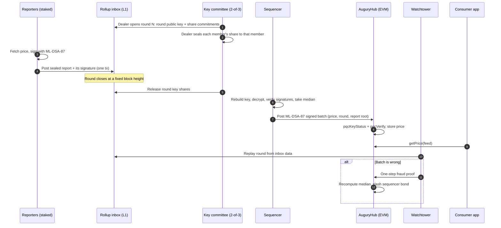
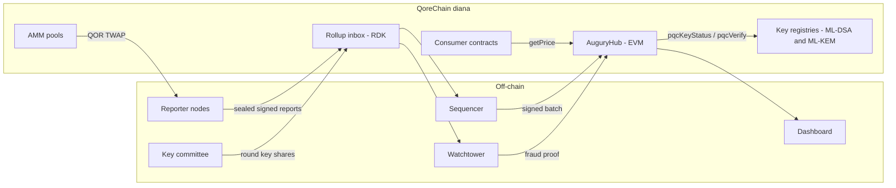

# Augury

**A post-quantum oracle network, built as a rollup on QoreChain. Prices nobody can copy, fake, or forge, even after Q-Day.**

Built for [Build Before Q-Day](https://build.qorechain.io), the QoreChain Developer Fest, in the **Protocol Builders** category.

> **Status: in development.** This README describes the design we are building. Nothing below is live yet. As each part ships on the `qorechain-diana` testnet, its proof (transaction hashes, contract addresses, receipts) will be listed in [`EVIDENCE.md`](EVIDENCE.md).

---

## Contents

- [The problem](#the-problem)
- [What Augury does](#what-augury-does)
- [How a round works](#how-a-round-works)
- [Architecture](#architecture)
- [Cryptographic design](#cryptographic-design)
- [The watchtower and fraud proofs](#the-watchtower-and-fraud-proofs)
- [Staking, rewards and withdrawal](#staking-rewards-and-withdrawal)
- [Private feeds](#private-feeds)
- [Using Augury from a contract](#using-augury-from-a-contract)
- [Protocol Builders requirements](#protocol-builders-requirements)
- [QoreChain kits and network features](#qorechain-kits-and-network-features)
- [Security model](#security-model)
- [Repository layout](#repository-layout)
- [Getting started](#getting-started)
- [Roadmap](#roadmap)
- [Credits](#credits)
- [License](#license)

---

## The problem

Every DeFi application trusts a price: lending markets to decide liquidations, baskets to rebalance, agents to decide when to buy. Whoever controls the price controls the money behind it.

1. **QoreChain has no oracle network yet.** Applications sign their own prices with a single reporter key, so one key sets every price.
2. **Oracles are the single point of failure on Q-Day.** A quantum computer that recovers a classical signing key can forge price reports, and every protocol that trusts them can be drained at once.
3. **Oracle networks have an old incentive flaw: freeloading.** Reporters are paid for agreeing with the consensus, so a lazy reporter can wait, copy the others and still get paid. The usual fix is commit-reveal (post a hash of your value first, reveal it later), but that opens a second hole: a reporter who has seen the other reveals can refuse to reveal their own, which gives them an option to cheat.

## What Augury does

Augury is an oracle network whose every step that moves trust is post-quantum:

- **Staked reporters** sign each price with **ML-DSA-87** and seal it with **ML-KEM-1024** to a fresh **round key**. Until the round closes, the inbox holds only ciphertext, so no reporter can copy another.
- **A 2-of-3 committee releases the round key** when the round closes. Reporters never control the reveal, so they cannot withhold a value after seeing the others.
- **The sequencer** decrypts the round, checks every signature, takes the **median** and posts an **ML-DSA-87 signed batch** to QoreChain.
- **AuguryHub**, an EVM contract on QoreChain, verifies each batch with the `pqcVerify` and `pqcKeyStatus` precompiles before any application can read the price.
- **A watchtower** re-checks every round. A wrong median is proven on-chain in **one step** and the sequencer's bond is slashed.
- **Reporters withdraw** stake and rewards to L1 with a verified settlement receipt.
- **Private feeds** (for example a tokenized fund's NAV) are sealed to paying subscribers with **QoreSeal epoch keys**.

## How a round works



1. **Open.** Two committee members deal each round, rotating every round. Each creates its own fresh seed and publishes its ML-KEM-1024 public key with SHA-256 commitments to three seed parts; every member receives its two parts of each seed sealed with QoreSeal to its own key. Reports are sealed to both keys, so no single member, dealer included, can open them before the close.
2. **Report.** Each reporter fetches the price from its own sources, picks a fresh 32-byte salt and signs `(feed, round, price, timestamp, salt)` with its registered ML-DSA-87 key. In one transaction it posts two entries to the rollup inbox: the signed message sealed to both round keys (3,728 bytes), then the signature. QoreChain caps a rollup post at 6,144 bytes and an ML-DSA-87 signature is 4,627, so the signature travels in the clear; the salt stays sealed, so nobody can test guessed prices against it. The order of the inbox is fixed by QoreChain.
3. **Close.** At a fixed block height the round closes. Reports posted later are ignored.
4. **Release.** Two of the three committee members publish their shares, and anyone can rebuild the round's secret key.
5. **Aggregate.** The sequencer decrypts every report, drops invalid ones (bad signature, unregistered key, wrong round, duplicate), takes the median and posts a batch signed with ML-DSA-87.
6. **Settle.** AuguryHub checks the sequencer's key with `pqcKeyStatus`, verifies the batch with `pqcVerify` and stores the price with its round number and time.
7. **Watch.** The watchtower replays the round from inbox data. If the batch is wrong, it submits a fraud proof.

## Architecture



| Component | Role | Built with |
|---|---|---|
| **AuguryHub** | Stores signed batches, holds stakes and bonds, runs fraud proofs, pays withdrawals, serves prices | Solidity, Foundry |
| **Rollup** | Ordered inbox for sealed reports and key shares, batch anchors, settlement receipts | QoreChain RDK |
| **Reporter node** | Fetches prices, signs, seals, posts | TypeScript, `@qorechain/pqc`, QoreSeal, QoreChain SDK |
| **Key committee** | Holds and releases round key shares | TypeScript, `@qorechain/pqc` |
| **Sequencer** | Decrypts, validates, aggregates, posts signed batches | TypeScript, RDK, QoreChain SDK |
| **Watchtower** | Replays rounds and submits fraud proofs | TypeScript, QoreChain MCP server, SDK |
| **Dashboard** | Live feeds, rounds, receipts, slashing events, a demo consumer | React, QoreX integrations |

**A note on the RDK.** The RDK's built-in execution (`qledger-v1`) handles payments. Augury's state is prices, so aggregation runs in our sequencer, the inbox carries the sealed reports, and correctness is enforced by AuguryHub's fraud proof rather than by the RDK's payment execution.

## Cryptographic design

| Purpose | Algorithm | Why |
|---|---|---|
| Reporter signatures | ML-DSA-87 (FIPS 204) | A forged report must be impossible even with a quantum computer |
| Batch signatures | ML-DSA-87 | The sequencer's batches are what applications trust |
| Report sealing | ML-KEM-1024 (FIPS 203), via QoreSeal | Reports stay hidden until the round closes, which prevents copying |
| Private feeds | QoreSeal epoch keys (ML-KEM-1024) | Only current subscribers can read; a lapsed subscriber is rotated out |
| Hashing | SHA-256 | Report leaves and roots, seed-part commitments, feed ids. Matches the EVM's native `sha256` precompile, so the fraud proof can recompute roots cheaply |
| Transactions | Hybrid secp256k1 + ML-DSA-87 | QoreChain's post-quantum transaction format |

**Keys are registered on-chain with proof of possession.** AuguryHub refuses batches signed by keys that `pqcKeyStatus` does not show as registered. A reporter's key is pinned from `pqcKeyStatus` when it starts staking, and its reports are always checked against that pinned key, so rotating a key later cannot turn an honest batch into a provable fraud (see T14 in [`THREAT_MODEL.md`](THREAT_MODEL.md)).

**Domain separation.** Every signed message includes the chain ID, the AuguryHub address, the feed ID and the round number, so a signature cannot be replayed in another round, feed or deployment.

### Why seal to a round key instead of commit-reveal

| | Commit-reveal | Augury (sealed to the round key) |
|---|---|---|
| Transactions per reporter per round | 2 | 1 |
| Can a reporter copy others? | No | No |
| Can a reporter refuse to reveal after seeing others? | **Yes** | **No.** The committee reveals, not the reporter |
| Leftover trust | None | The key committee (see [Security model](#security-model)) |

## The watchtower and fraud proofs

A median of a handful of reports is cheap to recompute on-chain, so Augury needs no multi-round challenge game. A **one-step fraud proof** is enough:

1. The watchtower submits the round's signed reports and the released key shares.
2. AuguryHub checks each report's ML-DSA-87 signature with `pqcVerify` and checks that each report is in the batch's report root.
3. AuguryHub recomputes the median.
4. If it differs from the posted price, the batch is reverted and the **sequencer's bond is slashed**. Part of the bond goes to the watchtower.

The watchtower also catches:

| Fault | Evidence | Outcome |
|---|---|---|
| Wrong median | Signed reports + key shares | Sequencer bond slashed |
| Reporter equivocation (two signed prices in one round) | Both signed reports | Reporter stake slashed |
| Omitted reports | Inbox position of a valid report missing from the batch | Sequencer bond slashed |
| Late key release | Round close height vs. share posting height | Committee member penalised |
| Stalled batches | No batch within the deadline | Alert; standby sequencer may take over |

## Staking, rewards and withdrawal

- **Reporters** stake test tokens to join a feed and are rewarded per round from consumer fees.
- **The sequencer** posts a bond that fraud proofs can slash.
- **Withdrawals** are claimed on L1 against a verified settlement receipt. Stake is locked for a cooldown after a reporter's last round, so a reporter cannot misbehave and exit before being challenged.

## Private feeds

Some data must not be public: the daily NAV of a tokenized fund, a credit score, a proprietary index. Augury can run a feed whose aggregated values are sealed with **QoreSeal epoch keys** to the current subscriber group:

- Only paying subscribers can decrypt the value.
- When a subscription lapses, the epoch key rotates and the former subscriber cannot read new values.
- The `PrivateFeeds` contract stores a salted SHA-256 commitment to each value, signed with the publisher's ML-DSA-87 key and checked with `pqcVerify`, so a subscriber can prove to a contract (`verifyValue`) that the value they used is the one that was published. The salt travels only inside the sealed value, so nobody else can test guessed values against the commitment.
- Built in `packages/shared/src/privatefeed.ts` and `contracts/src/PrivateFeeds.sol`; `packages/node/scripts/private-feed.ts` runs it on the testnet.

## Using Augury from a contract

Planned interface (subject to change while we build):

```solidity
interface IAugury {
    /// Latest settled price for a feed, with its round and settlement time.
    function getPrice(bytes32 feedId)
        external
        view
        returns (int256 price, uint8 decimals, uint64 round, uint64 settledAt);
}

contract Example {
    IAugury public immutable augury;
    // Feed id = sha256("augury-feed:fBTC/USD"), see packages/shared/src/feeds.ts
    bytes32 public constant FBTC_USD =
        0x4bb79407dfad9e433ad54bfd5353fe075f319ef31887ca79b4b5b54a584bb1ad;

    constructor(IAugury _augury) { augury = _augury; }

    function btcPrice() external view returns (int256) {
        (int256 price,, , uint64 settledAt) = augury.getPrice(FBTC_USD);
        require(block.timestamp - settledAt < 10 minutes, "stale price");
        return price;
    }
}
```

**Feeds at launch:** fBTC/USD and fETH/USD from independent exchange sources fetched by each reporter, and QOR/USD from a time-weighted average of QoreChain's AMM pools.

## Protocol Builders requirements

| Requirement | How Augury meets it | Evidence |
|---|---|---|
| ML-DSA-signed batches | Every aggregated batch is signed with ML-DSA-87 and verified by AuguryHub | `EVIDENCE.md` (pending) |
| Withdrawal | Reporter stakes and rewards are withdrawn to L1 | `EVIDENCE.md` (pending) |
| Verified settlement receipt | Checked in the CLI, the browser and Solidity | `EVIDENCE.md` (pending) |
| Watchtower | One-step fraud proof plus equivocation, omission and late-release checks | `EVIDENCE.md` (pending) |
| ML-KEM data protection | Sealed reports and private feeds | `EVIDENCE.md` (pending) |
| Threat model | [`THREAT_MODEL.md`](THREAT_MODEL.md) | (pending) |

## QoreChain kits and network features

**Kits:** QoreChain SDK, `qorechain-pqc`, QoreSeal, RDK (library and CLI), QoreX integrations, MCP server and `qore` CLI, QoreScan.

**Network features:** hybrid ML-DSA-87 transactions, PQC key registration with proof of possession, scoped EVM windows, Solidity PQC signature check (`pqcVerify`), Solidity PQC key status (`pqcKeyStatus`), QoreSeal and the encryption key registry, RDK rollup, AMM pools, test tokens fUSD / fETH / fBTC, MCP server, QoreScan.

## Security model

The full analysis will live in [`THREAT_MODEL.md`](THREAT_MODEL.md). In short:

**What Augury protects against**
- Forged reports or batches, including by an attacker with a quantum computer (ML-DSA-87 everywhere, no `ecrecover`).
- Reporters copying each other (sealed reports).
- Reporters withholding a value after seeing others (the committee reveals).
- A sequencer posting a wrong price or dropping reports (one-step fraud proof, bond slashing).
- Reporters signing two prices in one round (equivocation slashing).
- Harvest-now-decrypt-later attacks on private feeds (ML-KEM-1024).

**What it does not protect against, and our assumptions**
- **Committee trust.** If two of the three committee members collude with a reporter, they can reveal reports early. Mitigation: committee members are staked and independent; later versions can use a larger threshold or time-lock encryption.
- **Majority manipulation.** If more than half of the reporters in a round lie together, the median moves. The median tolerates a minority of bad reporters, not a majority.
- **Source manipulation.** If the underlying markets are manipulated, honest reporters faithfully report the manipulated price.
- **Liveness.** If too few committee members are online, a round cannot close. The round is skipped and consumers see a stale timestamp.
- **Testnet only.** Augury runs on `qorechain-diana` and is not audited.

## Repository layout

```
augury/
├── contracts/              Foundry project
│   ├── src/AuguryHub.sol   Settlement, staking, fraud proofs, price reads
│   ├── src/libraries/      Fail-closed wrappers for the PQC precompiles
│   └── test/               Foundry tests and a mock precompile
├── packages/
│   ├── shared/             Message encoding, report root, median, ML-DSA-87 signing,
│   │                       QoreSeal sealing, round-seed sharing, inbox posts and the
│   │                       canonical round processor
│   ├── committee/          Dealing round keys, sealed share delivery, share release
│   ├── reporter/           Exchange price sources and sealed report building
│   ├── sequencer/          Signed batches from the canonical round rules
│   ├── watchtower/         Batch audits, challenge and equivocation evidence
│   └── e2e/                A full round across every role
├── scripts/clean.mjs       Removes everything installed or built locally
├── EVIDENCE.md             Proof for every claim about the chain
├── THREAT_MODEL.md
├── AI_USAGE.md
└── LICENSE
```

## Getting started

You need Node.js 24, pnpm and [Foundry](https://book.getfoundry.sh/).

```sh
git clone --recurse-submodules https://github.com/rocketpowerkille/Augury.git
cd Augury
pnpm install          # packages stay inside the repo (.pnpm-store/)

pnpm -r typecheck     # TypeScript, strict
pnpm -r test          # TypeScript tests, real ML-DSA-87 and QoreSeal
pnpm test:contracts   # Foundry tests

pnpm --filter @augury/shared check:precompile   # read-only check against the testnet precompile
pnpm clean            # delete node_modules, .pnpm-store and build output
```

### Running on the testnet

Every script that sends a transaction is a dry run unless you pass `--execute`. Account files hold mnemonics and live in `secrets/`, which git ignores.

1. **Create accounts**: one sequencer, three committee members, at least three reporters (the hub needs three reports per round) and a watchtower.
   ```sh
   node packages/node/scripts/new-account.ts sequencer
   node packages/node/scripts/new-account.ts committee-0   # also committee-1, committee-2
   node packages/node/scripts/new-account.ts reporter-0    # also reporter-1, reporter-2
   node packages/node/scripts/new-account.ts watchtower
   ```
2. **Fund them** with test QOR from the faucet. Creating the rollup needs a 10,000 QOR stake from the sequencer (1% is burned); posting to the inbox costs 10 uqor per byte.
3. **Register keys**: every account registers its ML-DSA-87 key; committee members also publish an ML-KEM-1024 key.
   ```sh
   node packages/node/scripts/setup-account.ts --account secrets/reporter-0.json --execute
   node packages/node/scripts/setup-account.ts --account secrets/committee-0.json --kem --execute
   ```
4. **Deploy** the rollup and AuguryHub, and bond the sequencer. This writes `deployments/testnet.json`.
   ```sh
   node packages/node/scripts/deploy.ts --account secrets/sequencer.json --committee 0x…,0x…,0x… --execute
   ```
5. **Stake** each reporter (1 QOR by default):
   ```sh
   node packages/node/scripts/stake.ts --account secrets/reporter-0.json --execute
   ```
6. **Run the roles**, each in its own terminal:
   ```sh
   pnpm augury committee  --account secrets/committee-0.json
   pnpm augury reporter   --account secrets/reporter-0.json
   pnpm augury sequencer  --account secrets/sequencer.json
   pnpm augury watchtower --account secrets/watchtower.json
   ```

Every EVM call to the hub goes through an EVM window that the account opens with a hybrid-signed (secp256k1 + ML-DSA-87) native transaction and that is scoped to the hub address alone.

## Roadmap

Done means built and tested; everything marked on chain has transaction hashes in [`EVIDENCE.md`](EVIDENCE.md).

- [x] AuguryHub: signed batches, staking, bond, signed exits and withdrawals, one-step fraud proof, equivocation slashing, `getPrice` / `getFinalPrice`, Foundry tests
- [x] Shared protocol: message encoding byte-matched to Solidity, ML-DSA-87 signing, QoreSeal sealing, 2-of-3 round-seed sharing, canonical round processor
- [x] Committee, reporter, sequencer and watchtower logic, with an end-to-end round test
- [x] Read-only check that the testnet `pqcVerify` precompile accepts our signatures
- [x] CI: contracts and TypeScript on every push
- [x] Chain adapters: verified inbox reads (checked live on testnet), inbox posts, AuguryHub calls through hub-scoped EVM windows, KEM registry, PQC key registration
- [x] Node: committee, reporter, sequencer and watchtower roles; account, deploy and stake scripts (dry run by default)
- [x] Settlement receipt verification in the CLI, in Solidity (`SettlementReceipts`) and in the browser (`web/verify-receipt`), checked on a real testnet receipt
- [ ] Anchor Augury's own rollup batches (needs a 1,000 QOR submitter bond)
- [x] Deployment to `qorechain-diana`: rollup `augury-oracle`, AuguryHub, 8 accounts with registered ML-DSA-87 keys (committee ML-KEM keys too), live rounds for fBTC/USD and fETH/USD
- [ ] QOR/USD feed from a TWAP of QoreChain's AMM pools
- [ ] Withdrawals with verified settlement receipts
- [x] Private feeds with QoreSeal epoch keys: `PrivateFeeds` contract, live on testnet with a subscriber rotated out
- [ ] Dashboard and demo consumer
- [x] Live fraud drill on testnet: a lying batch challenged by the watchtower and the sequencer's bond slashed
- [x] QoreScan in CI: every push inventories the contracts' cryptography (CycloneDX CBOM) and fails on anything quantum-vulnerable
- [ ] Demo video

## Credits

Built on the official QoreChain kits, all Apache-2.0:

- `@qorechain/pqc`: ML-DSA-87 signing and verification.
- `@qorechain/qoreseal`: ML-KEM-1024 envelopes for sealed reports and share deliveries, and epoch keys for private feeds.
- `@qorechain/sdk`: unified accounts, hybrid-signed native transactions, PQC key registration.
- `@qorechain/evm`: EVM windows and the `pqcKeyStatus` reads.
- `@qorechain/rdk`: the rollup inbox, settlement batches and receipt verification.
- `@qorechain/qorescan`: the cryptographic inventory (CBOM) of the contracts, run in CI.

Other open-source tools: [Foundry](https://github.com/foundry-rs/foundry) and [forge-std](https://github.com/foundry-rs/forge-std) for the contracts, [TypeScript](https://www.typescriptlang.org/) and [pnpm](https://pnpm.io/).

See [`AI_USAGE.md`](AI_USAGE.md) for how we use AI tools in this project.

## License

[MIT](LICENSE)
